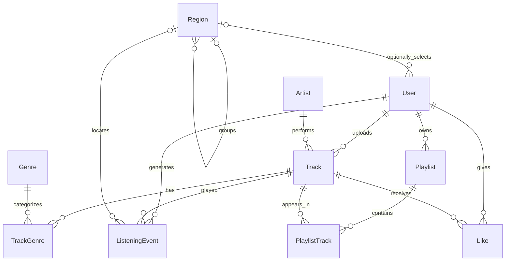

# Architecture and initial data model

## Simple modular monolith

React handles presentation, local player state, and HTTP requests. Express owns authentication, validation, business rules, uploads, and analytics queries. PostgreSQL stores identities, music metadata, interactions, and qualified events; local storage holds the audio bytes and covers. Prisma provides typed queries and versioned migrations. The frontend never imports the database client.

As features arrive, group API code by domain under `src/modules/auth`, `catalog`, `playlists`, `listening`, and `analytics`. Each module can have a router, service, validation functions, and tests. Do not create empty layers now. Share API types in a small package only when actual duplication appears. Client inputs always need runtime validation; TypeScript alone does not validate HTTP traffic.

## Initial entities (implemented in Prisma)

| Entity | Meaning and key constraints |
| --- | --- |
| User | Unique canonical email and username, password hash, optional consented coarse region, data origin |
| Artist | Catalog identity, nonunique display name (different artists may share names) |
| Track | Unique slug (lowercase words joined by hyphens, CHECK-enforced), primary artist, optional uploader (null for platform-curated tracks such as the seeded demo studies), positive duration, unique storage key, rights statement, cover key, origin |
| Genre / TrackGenre | Unique genre name and many-to-many track membership |
| Playlist / PlaylistTrack | Owner and visibility; unique membership and position within each playlist |
| Like | One like per user/track with timestamp |
| Region | Stable unique code, ISO country code, optional parent for country/region/city hierarchy |
| ListeningEvent | One qualified event per server-issued playback session; timestamp, duration, completion, region snapshot, discovery source, origin |

All IDs are UUIDs, times are PostgreSQL timestamps with time zone, and analytics use UTC half-open intervals `[start, end)`. Store durations in milliseconds and completion as a fraction in `[0,1]`. The server will derive completion from validated audio duration and measured unique timeline coverage; total repeat playback can exceed track duration. The session rules will be implemented in Phase 4.

Initial indexes cover track/artist/uploader lookups, user history, regional/time windows, and track/time windows with an explicit origin filter. Compound keys prevent duplicate likes, memberships, and session counting. B-tree title indexes support exact/prefix strategies as query plans allow; they do not make arbitrary case-insensitive substring search efficient. Add trigram/full-text indexes after measuring real catalog queries.

SQL CHECK constraints enforce positive durations, nonnegative playlist positions, completion bounds, and requiring consent when a user's selected region is present. SQL constraints cannot enforce cross-table event qualification, consent provenance, or equal data origin; those require transactional service logic and tests. User region is current preference; event region is a consented snapshot, never silently rewritten when a user moves.

## Deletion and ownership

Deleting a user cascades playlists, likes, and events. Tracks restrict uploader deletion to avoid silently destroying a public catalog; an account deletion service must first remove or explicitly transfer the user's uploads, within a documented workflow. Artists/genres in use cannot be removed accidentally. Track deletion cascades related interactions. Region deletion clears event/user references but a region with children must be reassigned first. Deleting an account is not implemented in Phase 1.

Future tables arrive through migrations: sessions in Phase 2; `UserFollow(followerId, followingId)` with no self-follow; `Comment` with owner/moderation fields; `Review` with unique user/track and rating CHECK 1–5; `Album`/track ordering; and timestamped playlist-addition events for historical trends. Current playlist membership alone cannot reconstruct additions in a past window.

## Event validity and duplicates (implemented as policy `listen-v1`, 2026-11-17)

1. Authenticated server starts a playback session tied to one user and track; it issues the UUID. Client-supplied random UUIDs are not trusted sessions.
2. Periodic sequenced heartbeats report playback progress. Server bounds elapsed listening by wall-clock time and playback state; paused time and seeking do not create listening time. Track unique media timeline intervals for completion; a seek to the end is not completion.
3. Qualify after at least `min(30 seconds, 50% of track duration)` of accumulated accepted playback. Keep partial progress in the session service, not the qualified-event table.
4. Insert at most one qualified event per session. A database unique key plus transactional upsert handles retries and concurrent reports. Add session persistence before enabling ingestion.
5. A genuine replay starts another session; enforce an initial per-user/track cooldown of 30 minutes for counted streams. Retain a policy version when implementing collection so later rule changes are documented.
6. Unique listeners count distinct users per track/window regardless of replays; cap repeat contribution per user/day in scoring. This reduces simple inflation but is not a claim of fraud-proof measurement.
7. Derive timestamp, identity, origin and consented coarse region on the server. Never trust them from a request body. Null region remains valid for non-geographic analytics.

## Privacy and reproducibility

Location selection is optional and explicit. Do not use GPS, stored raw IPs, or inferred city. At withdrawal, clear the profile region and historical per-user event region links; recompute any derived tables. Suppress all regional charts/comparisons below 10 distinct consented users per requested cohort, including comparisons and complementary slices that could reveal a hidden small group. Restrict available filters and use consistent windows to reduce differencing attacks. Suppression is a university-project safeguard, not a claim of formal differential privacy or guaranteed anonymity.

Tag synthetic users, tracks and events with `SYNTHETIC`. Every future query must explicitly select REAL or SYNTHETIC, never blend them by default. Generate from a fixed seed and a fixed reference date with known trends, regional preferences, cold-start cases, retries, and invalid playback examples. That generator is planned for Phase 4, not implemented yet. For personal preferences, include only accepted events and avoid exposing user-level records through public aggregate endpoints.

Backups, data retention windows, legal terms, moderation, production TLS, CSRF/session hardening, and upload safety require an explicit deployment checklist in Phase 7. Phase 1 is bound to localhost.

## Relationship overview

## Phase 1 HTTP contract

| Request | Success | Failure |
| --- | --- | --- |
| `GET /api/health` | 200: `status: ok`, service and phase | Process unreachable if stopped |
| `GET /api/ready` | 200: `status: ready`, `database: connected` after `SELECT 1` | 503: `status: unavailable`, `database: disconnected` |
| Unknown route | — | 404 JSON error |

Readiness does not inspect migration state. Requests use JSON; bodies larger than 32 KiB are rejected. Uploads will need a dedicated bounded multipart route. Database errors never return connection strings to clients.

## Catalog HTTP contract (implemented 2026-11-17)

Public and read-only; no session required and no user data exposed. Every query is restricted to `dataOrigin = REAL`, so synthetic evaluation tracks never appear in the product catalog.

| Request | Success | Failure |
| --- | --- | --- |
| `GET /api/catalog/tracks?q=&genre=&limit=&offset=` | 200: `{ tracks, total, limit, offset }`; `q` matches title, artist or genre (case-insensitive, ≤100 chars), `genre` is an exact case-insensitive name, `limit` 1–100 (default 50), `offset` 0–10000; ordered by creation time, then slug | 400 for unknown, repeated or out-of-range parameters |
| `GET /api/catalog/tracks/:ref` | 200: `{ track }`, `ref` is a UUID or slug | 400 malformed reference; 404 unknown or non-REAL track |
| `GET /api/catalog/genres` | 200: `{ genres: [{ name, trackCount }] }`, REAL tracks only, empty genres omitted | — |

A track is returned as `{ id, slug, title, artist: { id, name }, genres, durationMs, audioUrl, coverUrl }`. Storage keys, uploader, rights text and origin stay server-side. Keys beginning `static/` are bundled demo assets served by the frontend (`static/audio/study-0.wav` → `/audio/study-0.wav`); any other key has a `null` URL until the upload/streaming step serves files through the API with access checks.

The demo catalog is inserted by `npm run db:seed` (`src/modules/catalog/seed.ts`): one transaction, rows matched by a fixed artist ID, unique genre name and unique track slug, so re-running it updates the same rows and keeps track UUIDs stable. It never deletes other catalog data. The demo studies are marked REAL: they are actual playable catalog entries; "synthesized audio" is unrelated to the SYNTHETIC label, which is reserved for generated evaluation users and events.

## Library HTTP contract (implemented 2026-11-17)

All routes require a valid session. The owner is always the session user; IDs in the URL only choose the item, and a playlist owned by someone else returns 404 (its existence is not revealed). Mutations also require an exact allowed `Origin`; bodies must be JSON. Path IDs must be UUIDs (400 otherwise). Only REAL catalog tracks can be liked or added (404 otherwise).

| Request | Success |
| --- | --- |
| `GET /api/library` | 200 `{ library: { likedTrackIds, playlists: [{ id, title, isPublic, trackIds }] } }`, likes in like order, tracks in playlist order |
| `PUT` / `DELETE /api/library/likes/:trackId` | 204, idempotent |
| `POST /api/library/playlists` `{ title }` | 201 `{ playlist }`; title trimmed, 1–80 characters, no control characters; at most 200 playlists (409) |
| `DELETE /api/library/playlists/:playlistId` | 204; memberships cascade |
| `PUT` / `DELETE /api/library/playlists/:playlistId/tracks/:trackId` | 204, idempotent; appended at the end; at most 500 tracks (409) |
| `POST /api/library/import` `{ liked, playlists: [{ title, trackIds }] }` | 200 `{ library, imported: { likesAdded, playlistsCreated, playlistsMerged, tracksAdded, skipped } }` |

Concurrency: adding a track locks the playlist row (`FOR NO KEY UPDATE`) before computing the next position, so parallel additions never collide on the unique `(playlistId, position)` key. Positions only define order; removal leaves gaps rather than renumbering (renumbering under a non-deferrable unique key can conflict mid-update). Creating a playlist locks the owner row so the 200-playlist limit cannot be exceeded by parallel requests. The database also rejects blank titles (`Playlist_title_not_blank`).

Guests and import: guests keep likes and playlists in `localStorage` (per account ID or `guest`). After sign-in, the browser collection stored for *that account* is sent once to `/import` in one transaction (all or nothing). Legacy IDs and removed tracks are skipped and counted; likes are de-duplicated; a playlist whose title already exists is merged rather than duplicated, so a retry after a lost response is harmless. The browser copy is cleared only after the server confirms. The guest collection is not imported automatically into whichever account signs in next, because on a shared computer it may belong to someone else; it remains available when signed out. Joined communities remain browser-local until the communities step.

## Listening HTTP contract (implemented 2026-11-17)

Formal definition of crediting and qualification: MATHEMATICS.md section 0. Partial progress is stored in `PlaybackSession` (sequence, last position/state/time, accepted milliseconds, merged coverage intervals as JSON); only counted listens become `ListeningEvent` rows (unique `playbackSessionId`, `policyVersion`).

| Request | Notes |
| --- | --- |
| `POST /api/listening/sessions` `{ trackId, source }` | Session + origin + JSON. Track must be REAL and the user's origin must equal the track's (409 otherwise). At most 30 sessions per user per minute (429). Returns `{ session }` with `heartbeatIntervalMs` and `qualifyAfterMs`. |
| `POST /api/listening/sessions/:id/heartbeats` `{ sequence, positionMs, playing }` | Exactly these keys. Locks the session row, applies the policy, qualifies/counts in the same transaction. Older or repeated sequences are ignored. Someone else's session: 404. Ended or older than 6 h: 409. |
| `POST /api/listening/sessions/:id/end` `{}` or a final heartbeat | Idempotent. |
| `GET /api/listening/history?limit=1..50` | Signed in; the caller's counted listens, most recent first, with `total`. |
| `GET /api/listening/tracks/:trackId/stats` | Public. REAL counted listens and distinct listeners, all time, shown only when there are at least 10 distinct listeners (otherwise `null`); `yourListens` only for a valid session cookie. |

Identity, time, origin and region are always server-derived. The region snapshot is the user's region, which by the existing CHECK can only be set with location consent; there is no region-selection UI yet (Music Pulse step), so it is currently null. The browser reports only for signed-in users and catalog tracks; guests and local files are never recorded. A session starts on actual playback, not on selection. Source is `SEARCH` while searching, `PLAYLIST` from Your library, otherwise `CATALOG`.

## Music Pulse and location (implemented 2026-11-17)

| Request | Notes |
| --- | --- |
| `GET /api/pulse?origin=REAL\|SYNTHETIC&region=XX` | Public aggregates for one origin (never blended). REAL closes at today's UTC midnight (complete days); SYNTHETIC closes at the stored dataset's fixed reference date. Returns windows, rules, summary, capped genre shares, daily unique listeners with 7-day moving average, trend rows with every component, popularity list, and per-region comparison by total variation distance. A cohort under 10 distinct listeners returns no numbers at all (`suppressed`); per-day values, previous-week counts, popularity entries and region rows under 10 are hidden individually. 404 when no synthetic dataset exists. |
| `GET /api/pulse/regions` | Country-level regions (reference data from `npm run db:seed`). |
| `GET` / `PUT` / `DELETE /api/location` | Session required; PUT/DELETE need a trusted origin. PUT `{ code, consent: true }` sets the region and consent time; moving keeps earlier events' snapshots. DELETE clears region and consent and removes the region from all of the user's past events in one transaction. |

Computation loads 34 days of one origin's events and runs the pure `computePulse`. This is adequate for the demonstration volumes (≈35 000 synthetic events); larger data would need SQL aggregation or materialized daily tables (Phase 7). The synthetic dataset (`npm run db:synthetic`) is deterministic (generator `synthetic-v2`, seed 20261117, reference date 2026-11-16, 900 users in 16 countries plus Iceland with 8 listeners — deliberately below the privacy threshold — 36 tracks, 8 weeks; each country's genre taste is a seeded Dirichlet(2) draw, not a claim about the real country); its parameters and planted truth are stored in `SyntheticDataset`. (`synthetic-v1`, used before 2026-11-17 evening, had 600 users in 5 hand-specified regions.)

**Countries and map.** Regions are the 236 countries and territories with an ISO 3166-1 alpha-2 code in Natural Earth 1:50m Admin 0 (public domain), seeded by `npm run db:seed`. `scripts/build-world-map.py` projects them with Equal Earth (an equal-area projection suited to thematic maps), simplifies outlines (Douglas–Peucker, 0.35 px; closed rings split at their farthest vertex) and writes `apps/web/public/geo/countries.json` (≈160 KiB, served statically) and `apps/api/src/modules/analytics/countries.ts`. Three features without a code (Somaliland, N. Cyprus, Siachen Glacier) are drawn but not selectable; Antarctica is omitted. The Pulse map colours countries with a single-hue sequential ramp (listeners, share of one chosen genre, or similarity = 1 − TV to the selected country); a categorical "leading genre" map was rejected because six genre colours cannot all stay distinguishable for colour-blind readers when any two can be neighbours (validated with the dataviz palette checker). Countries under 10 listeners are grey. Small countries get clickable dots; the country list remains the accessible alternative. Regenerating replaces only the generator's own rows (accounts ending `@synthetic.invalid`, tracks `syn-track-*`); synthetic accounts cannot sign in and synthetic tracks never appear in the catalog.

Known privacy limitation: with "All regions" selected, global numbers minus visible regions can narrow down hidden regions plus people without a region. Filters are restricted (origin and one region) and windows are fixed to reduce differencing, but this is not formal anonymity.

## Recommendations (implemented 2026-11-17)

`GET /api/recommendations?limit=1..20` (session required, `no-store`) returns `{ recommendations: [{ track, reason }], basis, rules }`. It uses REAL data only: counted listens of real accounts in the last 180 days on REAL catalog tracks. Tracks the user heard in that window or liked are excluded. Personal picks (`reason: neighbours`) use the cosine-neighbour method of MATHEMATICS.md section 1 with 20 neighbours and require at least 5 similar listeners; otherwise platform popularity (`popular`) is used, and a short list is completed with unheard catalog tracks (`catalog`). Explanations are qualitative ("similar listeners play this") and never name or count other people. Plays started from Discover → For you are recorded with source `RECOMMENDATION`. The model is refitted per request, which is adequate for the demonstration's data volume.

## Community extension

See [Communities and social discovery](COMMUNITIES.md) for the planned social entities, membership history, community preference vectors, normalized matching score, chronological evaluation and Community Pulse privacy rules. These extend the existing models and arrive in later migrations and feature phases.
