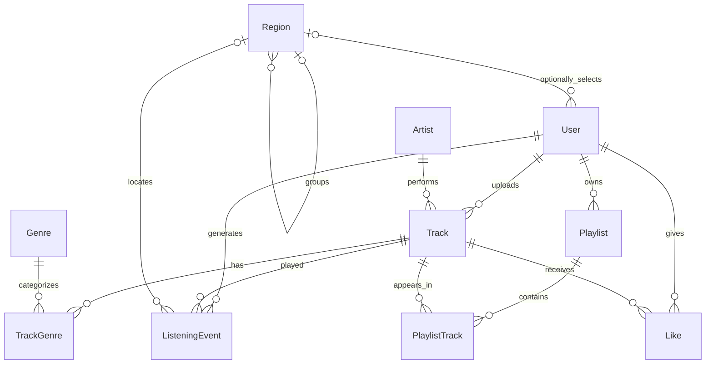

# Architecture and initial data model

## Simple modular monolith

React handles presentation, local player state, and HTTP requests. Express owns authentication, validation, business rules, uploads, and analytics queries. PostgreSQL stores identities, music metadata, interactions, and qualified events; local storage holds the audio bytes and covers. Prisma provides typed queries and versioned migrations. The frontend never imports the database client.

As features arrive, group API code by domain under `src/modules/auth`, `catalog`, `playlists`, `listening`, and `analytics`. Each module can have a router, service, validation functions, and tests. Do not create empty layers now. Share API types in a small package only when actual duplication appears. Client inputs always need runtime validation; TypeScript alone does not validate HTTP traffic.

## Initial entities (implemented in Prisma)

| Entity | Meaning and key constraints |
| --- | --- |
| User | Unique canonical email and username, password hash, optional consented coarse region, data origin |
| Artist | Catalog identity, nonunique display name (different artists may share names) |
| Track | Primary artist, uploader, positive duration, unique storage key, rights statement, cover key, origin |
| Genre / TrackGenre | Unique genre name and many-to-many track membership |
| Playlist / PlaylistTrack | Owner and visibility; unique membership and position within each playlist |
| Like | One like per user/track with timestamp |
| Region | Stable unique code, ISO country code, optional parent for country/region/city hierarchy |
| ListeningEvent | One qualified event per server-issued playback session; timestamp, duration, completion, region snapshot, discovery source, origin |

All IDs are UUIDs, times are PostgreSQL timestamps with time zone, and analytics use UTC half-open intervals `[start, end)`. Store durations in milliseconds and completion as a fraction in `[0,1]`. The server will derive completion from validated audio duration and measured unique timeline coverage; total repeat playback can exceed track duration. The session rules will be implemented in Phase 4.

Initial indexes cover track/artist/uploader lookups, user history, regional/time windows, and track/time windows with an explicit origin filter. Compound keys prevent duplicate likes, memberships, and session counting. B-tree title indexes support exact/prefix strategies as query plans allow; they do not make arbitrary case-insensitive substring search efficient. Add trigram/full-text indexes after measuring real catalog queries.

SQL CHECK constraints enforce positive durations, nonnegative playlist positions, completion bounds, and requiring consent when a user's selected region is present. SQL constraints cannot enforce cross-table event qualification, consent provenance, or equal data origin; those require transactional service logic and tests. User region is current preference; event region is a consented snapshot, never silently rewritten when a user moves.

## Deletion and ownership

Deleting a user cascades playlists, likes, and events. Tracks restrict uploader deletion to avoid silently destroying a public catalog; an account deletion service must first remove or explicitly transfer the user's uploads, within a documented workflow. Artists/genres in use cannot be removed accidentally. Track deletion cascades related interactions. Region deletion clears event/user references but a region with children must be reassigned first. Deleting an account is not implemented in Phase 1.

Future tables arrive through migrations: sessions in Phase 2; `UserFollow(followerId, followingId)` with no self-follow; `Comment` with owner/moderation fields; `Review` with unique user/track and rating CHECK 1–5; `Album`/track ordering; and timestamped playlist-addition events for historical trends. Current playlist membership alone cannot reconstruct additions in a past window.

## Event validity and duplicates (planned contract)

1. Authenticated server starts a playback session tied to one user and track; it issues the UUID. Client-supplied random UUIDs are not trusted sessions.
2. Periodic sequenced heartbeats report playback progress. Server bounds elapsed listening by wall-clock time and playback state; paused time and seeking do not create listening time. Track unique media timeline intervals for completion; a seek to the end is not completion.
3. Qualify after at least `min(30 seconds, 50% of track duration)` of accumulated accepted playback. Keep partial progress in the session service, not the qualified-event table.
4. Insert at most one qualified event per session. A database unique key plus transactional upsert handles retries and concurrent reports. Add session persistence before enabling ingestion.
5. A genuine replay starts another session; enforce an initial per-user/track cooldown of 30 minutes for counted streams. Retain a policy version when implementing collection so later rule changes are documented.
6. Unique listeners count distinct users per track/window regardless of replays; cap repeat contribution per user/day in scoring. This reduces simple inflation but is not a claim of fraud-proof measurement.
7. Derive timestamp, identity, origin and consented coarse region on the server. Never trust them from a request body. Null region remains valid for non-geographic analytics.

## Privacy and reproducibility

Location selection is optional and explicit. Do not use GPS, stored raw IPs, or inferred city. At withdrawal, clear the profile region and historical per-user event region links; recompute any derived tables. Suppress all regional charts/comparisons below 10 distinct consented users per requested cohort, including comparisons and complementary slices that could reveal a hidden small group. Restrict available filters and use consistent windows to reduce differencing attacks. Suppression is a university-project safeguard, not a claim of formal differential privacy or guaranteed anonymity.

Tag synthetic users, tracks and events with `SYNTHETIC`. Every future query must explicitly select REAL or SYNTHETIC, never blend them by default. Generate from a fixed seed and a fixed reference date with known trends, regional preferences, cold-start cases, retries, and invalid playback examples. That generator is planned for Phase 4, not implemented yet. For personal preferences, include only accepted events and avoid exposing user-level records through public aggregate endpoints.

Backups, data retention windows, legal terms, moderation, production TLS, CSRF/session hardening, and upload safety require an explicit deployment checklist in Phase 7. Phase 1 is bound to localhost.

## Relationship overview

## Phase 1 HTTP contract

| Request | Success | Failure |
| --- | --- | --- |
| `GET /api/health` | 200: `status: ok`, service and phase | Process unreachable if stopped |
| `GET /api/ready` | 200: `status: ready`, `database: connected` after `SELECT 1` | 503: `status: unavailable`, `database: disconnected` |
| Unknown route | — | 404 JSON error |

Readiness does not inspect migration state. Requests use JSON; bodies larger than 32 KiB are rejected. Uploads will need a dedicated bounded multipart route. Database errors never return connection strings to clients.
